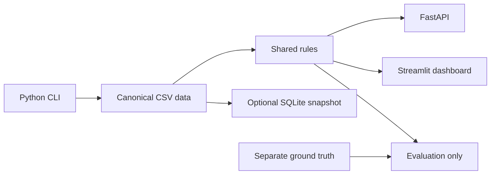

# Architecture

Python standard library handles deterministic generation, CSV/JSON, integer money, date/time and hashing. FastAPI/Pydantic provide the HTTP contract; Streamlit/pandas provide review screens. CSV is canonical; SQLite is an optional snapshot. Rules live in `app/rules.py`; generation, detection and validation are in `app/generator.py`.

## Limits

This is a local single-process reference implementation. It lacks authentication, production concurrency-safe posting, advanced accruals, production access controls, and jurisdiction-specific legal review. Contact windows are stated example rules and must be reviewed before real use. The priority score is not a predictive model.
