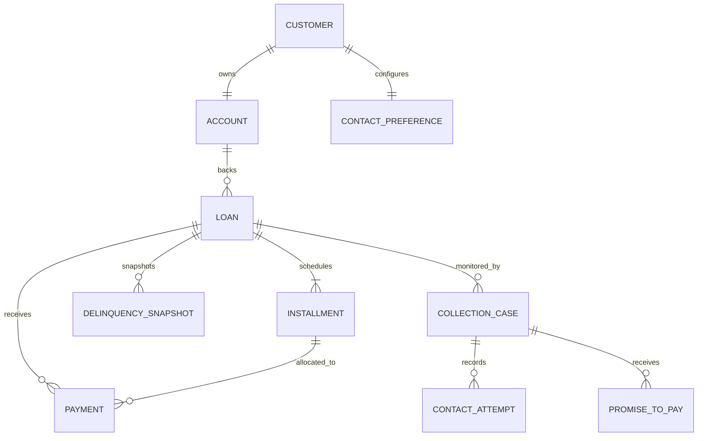

# Relational schema and lifecycle

All IDs are immutable text primary keys. `*_paise` values are integer paise. Dates are ISO-8601.

Generated records use one customer to one account and preference, one account to one loan (the model permits account-to-loan one-to-many), three installments and one snapshot per loan, and one case per loan. A loan has many payments; a case has many contact attempts and promises. Each payment stores one installment allocation; split payments use multiple payment rows. Contact attempts and payments are append-only events. Promise state: pending, fulfilled, partially_fulfilled, missed.

| Entity | Primary key | Foreign keys |
|---|---|---|
| Customer | customer_id | — |
| Account | account_id | customer_id → Customer |
| Loan | loan_id | account_id → Account |
| Installment | installment_id | loan_id → Loan |
| DelinquencySnapshot | snapshot_id | loan_id → Loan |
| ContactPreference | preference_id | customer_id → Customer |
| ContactAttempt | contact_attempt_id | case_id → CollectionCase |
| PromiseToPay | promise_id | case_id → CollectionCase; loan_id → Loan |
| Payment | payment_id | loan_id → Loan; customer_id → Customer; allocation_installment_id → Installment |
| CollectionCase | case_id | loan_id → Loan; customer_id → Customer |

Ground truth is separate from operational entities and detector inputs.

`event_history.csv` is an append-only audit stream (event ID, entity, event type, timestamp, and details) for generated payments, contacts, promise creation/reconciliation, and API operations. It supplements the ten domain entities without changing their cardinalities.
